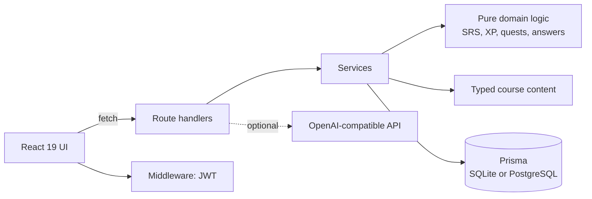

**English** · [Русский](README.ru.md)

<div align="center">

# Duoduo 🦉

**A gamified English and Chinese learning platform for Russian speakers.**
Two full courses, SM-2 spaced repetition, boss fights, weekly leagues and a
real backend, all in one deployable Next.js app.

[](https://github.com/Venius24/duoduo/actions/workflows/ci.yml)
[](LICENSE)


</div>

```bash
git clone https://github.com/Venius24/duoduo.git && cd duoduo
cp .env.example .env            # then put a real JWT_SECRET in it (npm run gen:secret)
npm run setup && npm run dev    # http://localhost:3000
```

Demo account after seeding: `demo@duoduo.app` / `demo123`

> The interface and lesson prompts are in Russian: the audience is Russian
> speakers learning English and Mandarin. The code, docs and commit messages are
> in English. Interface i18n is on the [roadmap](#roadmap).

---

## Why this project is interesting

Language-learning apps look like a pile of UI, but the hard parts are
engineering problems. This repository is a compact, tested example of solving
them without reaching for a heavyweight stack.

| Problem | How it is solved | Where |
|---|---|---|
| When should a word come back? | SM-2 as a **pure function with an injectable clock**, so scheduling is unit-tested deterministically | [`src/lib/srs.ts`](src/lib/srs.ts), [ADR 0002](docs/adr/0002-sm2-as-a-pure-function.md) |
| Where does business logic live? | Thin route handlers, a **service layer**, and an I/O-free domain layer | [`src/server/services`](src/server/services), [ADR 0001](docs/adr/0001-service-layer-over-route-handlers.md) |
| What if someone forgets `JWT_SECRET`? | The app **refuses to start** in production with a missing, short or template secret | [`src/server/env.ts`](src/server/env.ts), [ADR 0003](docs/adr/0003-stateless-jwt-and-fail-fast-secret.md) |
| SQLite on a VPS, Postgres on Vercel? | One schema, provider switched at build time | [`scripts/set-db-provider.mjs`](scripts/set-db-provider.mjs), [ADR 0004](docs/adr/0004-switchable-database-provider.md) |
| Brute-forcing the login | Sliding-window limiter, `429` with `Retry-After` | [`src/server/rate-limit.ts`](src/server/rate-limit.ts), [ADR 0005](docs/adr/0005-in-memory-rate-limiter.md) |
| Hearts that regenerate, weekly resets | **Derived from timestamps**, no cron or workers, so it runs on serverless | [`src/server/services/users.ts`](src/server/services/users.ts) |
| A one-letter typo, or pinyin typed without tone marks | Answer normalisation plus Levenshtein typo tolerance | [`src/lib/normalize.ts`](src/lib/normalize.ts) |
| Is the AI feature a hard dependency? | No: it **degrades to a local explanation** on any failure | [`src/server/ai.ts`](src/server/ai.ts), [ADR 0007](docs/adr/0007-optional-ai-with-local-fallback.md) |

All seven decisions are written up as
[Architecture Decision Records](docs/adr/README.md), including the alternatives
that were rejected and what each choice costs.

## Features

- **Two courses.** English Flow (6 units, 24 lessons, 6 bosses) and the
  Dragon Path for Chinese (6 units, 24 lessons, a dragon boss).
- **10 exercise types.** Multiple choice, word bank, typed answer (pinyin for
  Chinese), listening, dictation, matching pairs, speaking, fill-in-the-blank, a
  tone trainer and grammar cards.
- **Spaced repetition.** SM-2 review queue with lapse handling.
- **Game loop.** Streaks, gems, hearts with automatic regeneration, daily
  quests, 10 achievements, XP levels with titles, unit bosses with a pass mark
  and star ratings.
- **Weekly league** against deterministic bot opponents.
- **Speech.** Pronunciation practice through the Web Speech API and word
  playback through browser TTS. Sound effects are synthesised with Web Audio, so
  there are no audio assets.
- **Optional AI.** Explains mistakes through any OpenAI-compatible API.
- **PWA manifest**, dark theme, responsive layout.

No external service is required for the core experience: the database is a file,
speech is the browser's, sounds are generated.

## Architecture at a glance



Layers only depend downwards, and the domain layer does no I/O. The full
write-up, data model and the lesson-completion walkthrough are in
[docs/architecture.md](docs/architecture.md).

A taste of the code: the whole scheduler is a pure function.

```ts
export function nextSchedule(prev: SrsState, grade: number, now: Date = new Date()): ScheduledItem {
  let { ease, interval, reps, lapses } = prev
  if (grade >= 3) {
    reps += 1
    if (reps === 1) interval = 1
    else if (reps === 2) interval = 3
    else interval = Math.max(1, Math.round(interval * ease))
    ease += grade === 5 ? 0.1 : grade === 4 ? 0 : -0.15
  } else {
    lapses += 1
    reps = 0
    interval = 0 // back in 10 minutes
    ease -= 0.2
  }
  // ...clamp ease, compute dueAt from `now`
}
```

## Tech stack

Next.js 15 (App Router) · React 19 · TypeScript · Tailwind CSS · Prisma 6
(SQLite or PostgreSQL) · `jose` + `bcryptjs` · zod · Zustand · Vitest and
Testing Library · Docker · GitHub Actions

## Getting started

Requires Node.js 20 or newer (`.nvmrc` is provided).

```bash
npm install
cp .env.example .env     # set DATABASE_URL and JWT_SECRET
npm run gen:secret       # prints a strong JWT_SECRET line
npm run db:push          # creates prisma/dev.db
npm run db:seed          # demo user and 26 league bots
npm run dev
```

`npm run setup` runs install, push and seed in one go.

| Command | What it does |
|---|---|
| `npm run dev` | Dev server |
| `npm run build` / `npm start` | Production build and server (provider picked automatically) |
| `npm test` | 75 tests |
| `npm run typecheck` | `tsc --noEmit` |
| `npm run verify` | Types, tests and build: exactly what CI runs |
| `npm run db:studio` | Prisma Studio |
| `npm run docker:up` | Build and start with Docker Compose |

### Configuration

| Variable | Required | Description |
|---|---|---|
| `DATABASE_URL` | yes | `file:./dev.db` (SQLite) or `postgresql://...` |
| `JWT_SECRET` | yes | Session signing secret, 24+ characters |
| `DATABASE_PROVIDER` | no | `sqlite` or `postgresql`, if auto-detection is wrong |
| `COOKIE_SECURE` | no | `1` to force the `Secure` cookie flag (needed behind a TLS proxy) |
| `OPENAI_API_KEY` | no | Enables AI explanations |
| `AI_BASE_URL`, `AI_MODEL` | no | Any OpenAI-compatible endpoint and model |
| `APP_VERSION` | no | Echoed by `/api/health` |

In production the server will not start without a valid `JWT_SECRET`. That is
deliberate; see [ADR 0003](docs/adr/0003-stateless-jwt-and-fail-fast-secret.md).

## Deployment

**Docker or a VPS (recommended).** SQLite on a persistent volume, nothing else
to run:

```bash
cp .env.example .env
npm run --silent gen:secret >> .env
npm run docker:up        # http://localhost:3000, data in the duoduo-data volume
```

The image is multi-stage on Next's `standalone` output, runs as a non-root user,
applies the schema on start, seeds an empty database once, and has a
`HEALTHCHECK` on `/api/health`. Behind a TLS-terminating proxy add
`COOKIE_SECURE=1`.

**Vercel and similar.** Use PostgreSQL (Neon, Supabase, Railway): serverless
filesystems are ephemeral and a SQLite file would be lost. Set `DATABASE_URL`,
`JWT_SECRET` and `COOKIE_SECURE=1`, deploy, then once:

```bash
DATABASE_URL="postgresql://..." npm run db:push
DATABASE_URL="postgresql://..." npm run db:seed
```

Check a deployment:

```bash
curl https://<your-domain>/api/health
# {"status":"ok","db":"up","latencyMs":4,"uptimeSec":12,"version":"1.0.0"}
```

`503` with `"status":"degraded"` means the process is alive but the database is
not reachable.

## Testing

75 tests across 6 files, run by `npm test` and on every push in CI:

| File | Covers |
|---|---|
| `normalize.test.ts` | Answer normalisation, typo tolerance, pinyin |
| `core.test.ts` | SM-2, levels and XP, quests, achievements, tones |
| `content.test.ts` | Structural validity of both courses |
| `services.test.ts` | **Integration against a real database:** register and login, a full lesson, a failed boss, review intervals, league ordering, idempotent quest rewards, heart regeneration |
| `security.test.ts` | Rate limiter and secret validation |
| `components/exercises.test.tsx` | Exercise UI behaviour |

The integration tests use their own `prisma/test.db`, so development data is
never touched. CI also type-checks, builds for production and builds the Docker
image.

## Security

- bcrypt password hashes; signed JWT in an `httpOnly`, `SameSite=Lax` cookie.
- Refuses to boot with an unsafe secret.
- Rate limits: login 10 per 10 minutes, registration 5 per hour, AI 30 per 5
  minutes.
- `X-Content-Type-Options`, `X-Frame-Options`, `Referrer-Policy` and
  `Permissions-Policy` headers; `no-store` on every API response.
- Every request body is validated with zod.

Found something? See [SECURITY.md](SECURITY.md).

## Project layout

```
prisma/        schema and seed (demo user, league bots)
scripts/       DB provider switch, secret generator
docker/        container entrypoint
docs/          architecture overview and ADRs
src/
  content/     courses (en.ts, zh.ts) and exercise builders
  lib/         pure domain logic: SRS, answers, levels, quests, achievements
  server/      env, auth, rate limit, AI client, services
  components/  UI kit, lesson runner, 10 exercise types
  app/         pages and API routes
  tests/       Vitest suites
```

Adding a unit means adding an object to the `units` array in
`src/content/en.ts` or `zh.ts`; `content.test.ts` validates it.

## Known limitations

Written down on purpose, because they are the honest next steps:

- **Lesson scores are client-reported.** `/api/lessons/complete` clamps and
  validates the numbers but cannot prove the learner answered correctly. That is
  acceptable for a personal learning tool; a public leaderboard would need
  server-side answer verification.
- **The rate limiter is per process** ([ADR 0005](docs/adr/0005-in-memory-rate-limiter.md)).
  Multiple instances need a shared store.
- **No migration history.** Both databases use `prisma db push`. Move to
  `prisma migrate` before a production upgrade path matters.
- **JWTs are not revocable** before they expire (30 days); rotating the secret
  signs everyone out.
- **No end-to-end browser tests yet.**

## Roadmap

- [ ] Server-side answer verification for league integrity
- [ ] `prisma migrate` and a documented upgrade path
- [ ] Redis-backed rate limiting behind the existing interface
- [ ] Interface i18n (English UI) and a third course
- [ ] Playwright end-to-end suite for the lesson flow
- [ ] Batch the first-time SRS inserts in `completeLesson`

## Contributing

Issues and pull requests are welcome. Read [CONTRIBUTING.md](CONTRIBUTING.md)
first; it is short.

## License

[MIT](LICENSE) © 2026 Venius24
