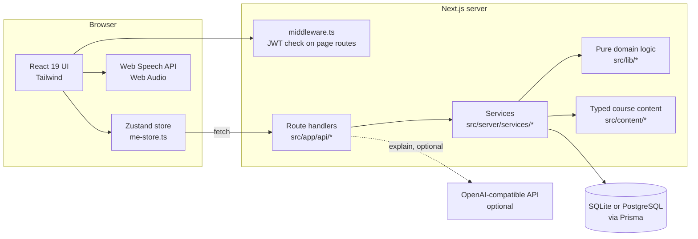
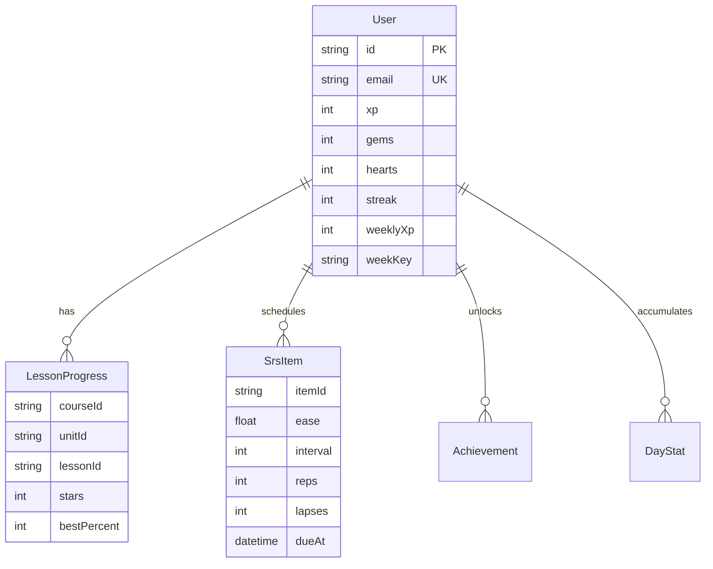

# Architecture

Duoduo is a single Next.js 15 application (App Router) that serves both the UI
and a JSON API, backed by Prisma. There is no separate backend process.

## Layers and their rules

| Layer | Path | May depend on | Must not |
|---|---|---|---|
| Pages and components | `src/app`, `src/components` | `lib`, `content` | import `server/*` |
| Route handlers | `src/app/api` | `server/*` | contain business rules |
| Services | `src/server/services` | `lib`, `content`, `db` | know about HTTP |
| Domain logic | `src/lib` | nothing but types | do I/O |
| Content | `src/content` | its own types | touch the database |

The domain layer (`src/lib`) is where the rules live: SM-2 scheduling, XP and
levels, quests, achievements and answer checking. Keeping it free of I/O is what
makes it cheap to test (see ADR 0001 and 0002).

## Request lifecycle: completing a lesson

1. The client finishes a lesson and `POST`s `/api/lessons/complete` with
   `{ courseId, unitId, lessonId, correct, total, seconds }`.
2. The handler loads the session user (`getSessionUser`: verify JWT, load row),
   validates the body with zod and calls `completeLesson`.
3. `completeLesson` looks the lesson up in the content tree, clamps the numbers,
   decides pass or fail (bosses have a `passScore`), and computes XP, gems,
   stars and the streak.
4. Counters, per-day stats and lesson progress are written in one
   `db.$transaction`.
5. Words from the lesson that the user has not seen get a first SRS schedule.
6. Achievements are re-evaluated; newly unlocked ones are inserted.
7. The result (XP gained, level-up, unlocked achievements) is returned to the UI.

## Data model

Every child row cascades on user deletion. `SrsItem` is indexed on
`(userId, dueAt)` because "what is due now" is the hottest query. Rows reference
course content by stable string ids, not foreign keys (ADR 0006).

## Time-derived state

Hearts and the weekly league are derived from time rather than ticked by a cron
job. `refreshUserState` runs on each `/api/me` read and:

- grants one heart per 20 minutes elapsed (`HEART_REGEN_MS`), capped at the
  maximum, and advances `heartsUpdated` by whole intervals only so partial
  progress is not lost;
- resets `weeklyXp` when the stored `weekKey` is not the current week.

This keeps the app free of background workers, which is what lets it run on
serverless platforms.

## The league

League opponents are seeded bot users. A bot's displayed score is
`weeklyXp * factor`, where `factor` is a deterministic hash of the bot id, week
and date, scaled by how far into the week it is. Scores therefore grow during
the week and are stable between page loads, without storing any extra state.

## Security surface

See ADR 0003 (sessions and secret), ADR 0005 (rate limits) and
[SECURITY.md](../SECURITY.md). Response headers are set in `next.config.mjs`,
and all `/api/*` responses are `Cache-Control: no-store`.

## Deployment shapes

| Target | Database | Notes |
|---|---|---|
| Docker or VPS | SQLite file on a volume | Multi-stage image on Next's `standalone` output, non-root user, `HEALTHCHECK` on `/api/health` |
| Vercel, Netlify, Cloud Run | PostgreSQL | Filesystem is ephemeral; the provider switch is automatic (ADR 0004) |

`/api/health` returns `200` with DB latency when the database answers and `503`
with `status: degraded` when it does not, so a load balancer can tell a live
process from a usable one.
